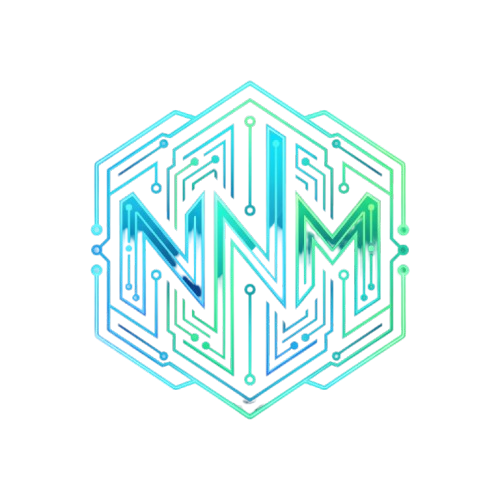
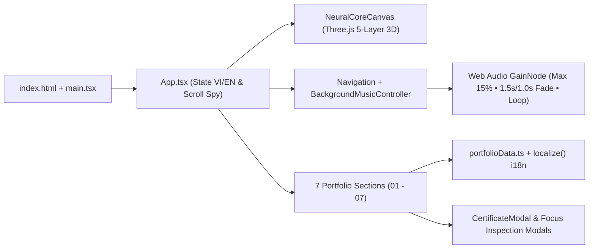

<div align="center">



# ✦ NGUYỄN NHẤT MINH — 3D INTERACTIVE PORTFOLIO ✦

### `~/portfolio $ ENGINEERING INTELLIGENCE. CREATING IMPACT.`

**Real-Time Three.js Quantum Neural Core • Applied AI • IT & EdTech Operations • Blockchain Research**

<p>
  <a href="https://react.dev/"></a>
  <a href="https://www.typescriptlang.org/"></a>
  <a href="https://threejs.org/"></a>
  <a href="https://tailwindcss.com/"></a>
  <a href="https://vite.dev/"></a>
</p>

<p>
  
  
  
  
</p>

[❖ Khám Phá Cấu Trúc 3D](#-kiến-trúc-lõi-lượng-tử-3d-quantum-neural-core) •
[♫ Hệ Thống Âm Thanh](#-hệ-thống-nhạc-nền-persistent-audio) •
[◈ Nội Dung & Chức Năng](#-các-phân-khu-chính-sections-01--07) •
[⚡ Cài Đặt & Chạy Dự Án](#-hướng-dẫn-cài-đặt--chạy-local)

</div>

---

## 🌌 Giới Thiệu Tổng Quan

Website Portfolio tương tác 3D của **Nguyễn Nhất Minh** (*Chuyên Viên Kỹ Thuật tại ISIEE — Cử Nhân Công Nghệ Thông Tin HUFLIT*), được kiến tạo theo phong cách **Cyber-Space / Neon Quantum Studio** trên nền không gian sâu `#03050B` kết hợp ánh sáng Cyan (`#00E5FF`), Violet (`#8B5CF6`) và Amber (`#F59E0B`).

Toàn bộ trải nghiệm được vận hành mượt mà trên nền tảng **Three.js WebGL 3D thời gian thực**, song ngữ **Tiếng Việt / Tiếng Anh**, cùng hệ thống nhạc nền không gian **Web Audio API**.

---

## 💠 Kiến Trúc Lõi Lượng Tử 3D (`Quantum Neural Core`)

Canvas 3D toàn màn hình trong [`NeuralCoreCanvas.tsx`](src/components/3d/NeuralCoreCanvas.tsx) được xây dựng theo cấu trúc **5 tầng không gian đồng tâm** với `ACESFilmicToneMapping` (`exposure: 0.72`), tối ưu độ dịu mắt giúp nổi bật chữ và tương tác mượt theo con trỏ chuột & cuộn trang:

```text
                    ╭───────────────────────────────────────────────╮
                    │   LAYER 5 ▸ 1,200 Volumetric Starfield Dust   │
                 ╭──┴───────────────────────────────────────────────┴──╮
                 │  LAYER 4 ▸ 4 Gimbal Torus Rings + 2 Orbit Drones    │
              ╭──┴─────────────────────────────────────────────────────┴──╮
              │ LAYER 3 ▸ 65 Synaptic Nodes + 14 Traveling Data Pulses    │
           ╭──┴───────────────────────────────────────────────────────────┴──╮
           │     LAYER 2 ▸ Geodesic Wireframe Exoskeleton (Icosahedron)      │
        ╭──┴─────────────────────────────────────────────────────────────────┴──╮
        │   LAYER 1 ▸ Quantum Crystal Nucleus + Octahedron Singularity Heart    │
        ╰───────────────────────────────────────────────────────────────────────╯
```

| Tầng 3D | Thành Phần Hình Học Three.js | Thông Số Kỹ Thuật |
| :--- | :--- | :--- |
| **Layer 1 — Nucleus** | `IcosahedronGeometry` + `EdgesGeometry` + `OctahedronGeometry` | Vật liệu `MeshPhysicalMaterial` (`metalness: 0.75`, `clearcoat: 0.8`), lõi phát xung wireframe |
| **Layer 2 — Exoskeleton** | `IcosahedronGeometry(1.9, 2)` + `WireframeGeometry` | Lồng trắc địa cộng hưởng chuyển động ngược chiều |
| **Layer 3 — Neural Cluster** | **65 nodes** phân bố Golden Spiral + `LineSegments` + **14 pulses** | Tự động nối synapse khoảng cách `< 1.35`, xung dữ liệu trắng chạy dọc liên kết |
| **Layer 4 — Gimbal Rings** | **4 Torus Rings** đa trục + **2 Orbiting Octahedron Drones** | Xoay lệch pha liên hoàn với ánh sáng Cyan (`#00E5FF`), Sky (`#38BDF8`) & Violet (`#8B5CF6`) |
| **Layer 5 — Starfield** | **1,200 particles** `BufferGeometry` + `FogExp2` | Độ sâu trường ảnh vũ trụ, tự căn chỉnh camera theo màn hình Mobile / Tablet / Desktop |

---

## ♫ Hệ Thống Nhạc Nền (`Persistent Audio`)

Được quản lý qua singleton [`BackgroundMusicController`](src/utils/backgroundMusic.ts) gắn với nút loa trên thanh Header ([`Navigation.tsx`](src/components/Navigation.tsx)):

- **Bản nhạc chính thức:** *Vastness — Andrew Ev* (Mixkit Free License, `/audio/vastness-andrew-ev.mp3`).
- **Mở mặc định & An toàn Autoplay:** Tự động phát ngay khi vào web (nếu trình duyệt chặn autoplay khi chưa có thao tác, hệ thống tự kích hoạt mượt ngay ở cú chạm/nhấp chuột/phím đầu tiên), xử lý qua `AudioContext` + `MediaElementAudioSourceNode` + `GainNode` đảm bảo trần âm lượng **tối đa 15%** kể cả trên **iOS Safari**.
- **Chuyển tiếp mượt mà:** **Fade-in 1.5 giây** khi bật, **Fade-out 1.0 giây** rồi tạm dừng giữ nguyên timestamp (`currentTime`) khi tắt, kèm cross-fade tại ranh giới lặp để **vòng lặp vô tận không có tiếng click/khựng**.
- **Bền vững xuyên suốt:** Không bị reset khi chuyển ngôn ngữ `VI ↔ EN`, cuộn trang hay đóng/mở Modal chi tiết.

---

## ◈ Các Phân Khu Chính (`Sections 01 – 07`)

| STT | Tiêu Đề Header | Tên Phân Khu | Điểm Nhấn Tương Tác |
| :---: | :--- | :--- | :--- |
| **00** | `HOME` | **Hero Section** | Typewriter role ticker động, khung avatar holographic, thanh chỉ số tốt nghiệp HUFLIT & ISIEE |
| **01** | `TẦM NHÌN` *(VISION)* | **Mục Tiêu Nghề Nghiệp** | Tuyên ngôn định hướng AI & Hệ thống cùng 4 trụ cột công nghệ cốt lõi |
| **02** | `HÀNH TRÌNH` *(JOURNEY)* | **Kinh Nghiệm Làm Việc** | Timeline tương tác accordion 5 cột mốc: **ISIEE**, **SELA HOLDINGS**, **CT-CTSV HUFLIT**, **CLB Fintech HUFLIT**, **FADA** |
| **03** | `NĂNG LỰC` *(CAPABILITIES)* | **Kỹ Năng & Công Nghệ** | Ma trận năng lực song ngữ hoàn chỉnh kèm bộ lọc tức thì theo từng nhóm chuyên môn |
| **04** | `ĐÓNG GÓP` *(IMPACT)* | **Dự Án & Lĩnh Vực Trọng Tâm** | 4 trọng tâm triển khai thực tế (OMO & ClassIn tại ISIEE, Generative AI tại SELA, On-chain tại FADA, Tech Leadership) kèm Modal chi tiết |
| **05** | `DẤU ẤN` *(RECOGNITION)* | **Thành Tích & Giải Thưởng** | Banner vàng danh giá Giải thưởng *Tìm Hiểu Tình Hữu Nghị Việt Nam - Lào 2026*, *Sinh Viên 5 Tốt*... + hiệu ứng Confetti |
| **06** | `NỀN TẢNG` *(FOUNDATION)* | **Học Vấn & Chứng Chỉ** | Bằng Cử Nhân CNTT HUFLIT + 4 Chứng chỉ chuyên ngành Google (07/2026) có **Modal xem chi tiết** + 3 Chứng chỉ Google Analytics |
| **07** | `KẾT NỐI` *(CONNECT)* | **Liên Hệ & Footer** | One-click copy Email / SĐT, liên kết LinkedIn & Facebook, khu vực Phường Vườn Lài, TPHCM |

---

## 🧭 Sơ Đồ Kiến Trúc Hệ Thống



---

## 📁 Cấu Trúc Thư Mục Dự Án

```text
portfolio_Nhat-Minh/
├── public/
│   ├── audio/
│   │   └── vastness-andrew-ev.mp3       # Nhạc nền Vastness — Andrew Ev (Mixkit)
│   ├── images/certs/                    # Ảnh preview các chứng chỉ Google (07/2026)
│   ├── 1766512773841.jpg                # Ảnh đại diện cá nhân
│   └── logo-tachne.png                  # Brand icon & favicon
├── src/
│   ├── components/
│   │   ├── 3d/
│   │   │   └── NeuralCoreCanvas.tsx     # Engine Three.js WebGL 3D 5 tầng
│   │   ├── ui/
│   │   │   ├── CertificateModal.tsx     # Modal kiểm tra chi tiết chứng chỉ Google
│   │   │   ├── CustomCursor.tsx         # Con trỏ từ tính phản hồi tương tác
│   │   │   └── Icons.tsx                # Custom SVG Icons (Google, LinkedIn, Facebook)
│   │   ├── Navigation.tsx               # Header, nút nhạc nền, chuyển ngôn ngữ VI/EN
│   │   ├── Hero.tsx                     # Hero section & role ticker
│   │   ├── About.tsx                    # 01 / Mục Tiêu Nghề Nghiệp
│   │   ├── ExperienceTimeline.tsx       # 02 / Kinh Nghiệm Làm Việc
│   │   ├── ExpertiseNetwork.tsx         # 03 / Kỹ Năng & Công Nghệ
│   │   ├── SelectedWork.tsx             # 04 / Dự Án & Lĩnh Vực Trọng Tâm
│   │   ├── Achievements.tsx             # 05 / Thành Tích & Giải Thưởng
│   │   ├── Education.tsx                # 06 / Học Vấn & Chứng Chỉ
│   │   └── Contact.tsx                  # 07 / Liên Hệ & Footer
│   ├── data/
│   │   └── portfolioData.ts             # Kho dữ liệu song ngữ toàn diện VI / EN
│   ├── utils/
│   │   ├── backgroundMusic.ts           # Singleton điều khiển nhạc nền & fade/loop
│   │   ├── i18n.ts                      # Helper phân giải văn bản song ngữ
│   │   └── soundEffects.ts              # Web Audio SFX synthesizer
│   ├── App.tsx
│   ├── index.css
│   └── types.ts
├── index.html
├── package.json
├── tailwind.config.js
└── vite.config.ts
```

---

## ⚡ Hướng Dẫn Cài Đặt & Chạy Local

```bash
# 1. Clone repository
git clone https://github.com/nhatminh122004/portfolio_Nhat-Minh.git
cd portfolio_Nhat-Minh

# 2. Cài đặt thư viện
npm install

# 3. Khởi chạy server phát triển (http://localhost:5173/)
npm run dev

# 4. Kiểm tra TypeScript & đóng gói Production vào thư mục dist/
npm run build

# 5. Xem trước bản build Production
npm run preview
```

---

<div align="center">

### 🤝 Kết Nối Với Nguyễn Nhất Minh

[](mailto:nhatminh122004@gmail.com)
[](https://www.linkedin.com/in/nguyennhatminh1/)
[](https://www.facebook.com/nhatminh19122004/)

**© 2026 Nguyễn Nhất Minh** — *Engineered with React, TypeScript & Three.js 3D Neural Core*

</div>
